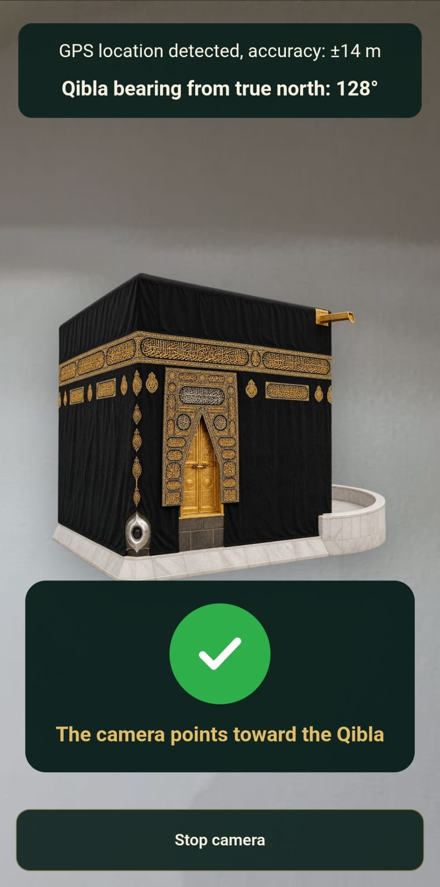
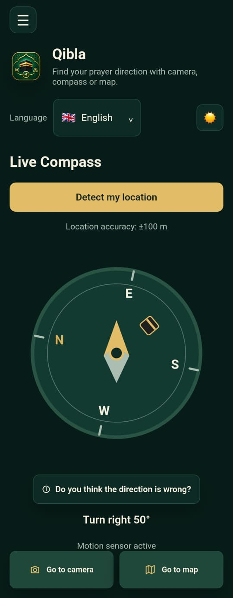
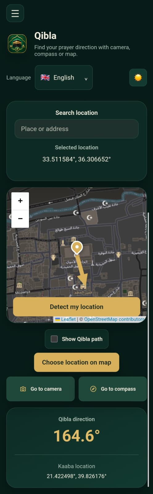
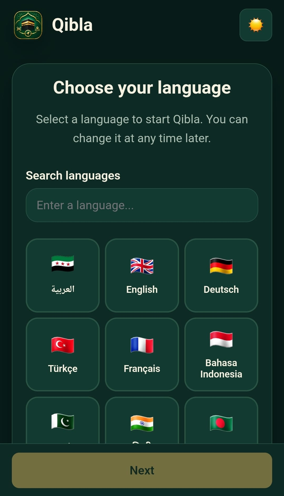
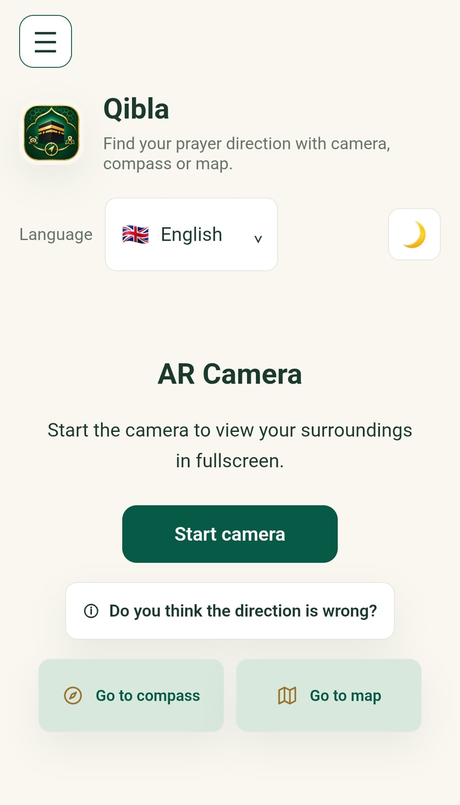
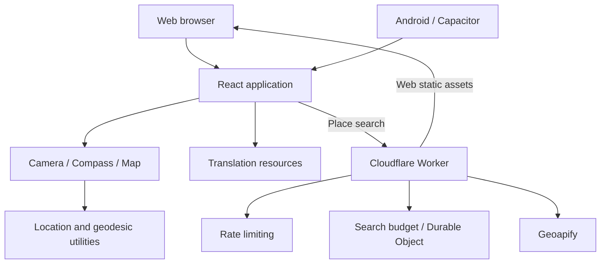

<div align="center">

# Qibla

**Find your prayer direction with camera, compass or map.**

A multilingual Qibla direction finder for the web and Android, built to make finding the direction of the Kaaba simple and accessible.

[](https://qibla.hussam-sattout.workers.dev/camera)
[](#languages)
[](https://www.typescriptlang.org/)
[](#android)
[](LICENSE)

**[Open Qibla](https://qibla.hussam-sattout.workers.dev/camera)** · [Features](#features) · [Screenshots](#screenshots) · [Languages](#languages) · [Development](#development) · [Deployment](#deployment)

</div>

---

## Overview

Muslims face the Kaaba in Makkah during prayer. Qibla helps users find that direction from their current location or a manually selected place.

Instead of relying on a single method, the application provides three complementary ways to orient yourself: camera-assisted guidance, a device compass and an interactive map. The map is particularly useful when device orientation sensors are unavailable or unreliable, as nearby streets and buildings can serve as visual reference points.

The web application is available directly in a modern browser without an app installation. An Android version is also maintained using Capacitor and can be built and tested locally with Android Studio.

## Features

| Feature                          | Description                                                                                                       |
| -------------------------------- | ----------------------------------------------------------------------------------------------------------------- |
| Camera guidance                  | Find the Qibla using a live camera view and an on-screen directional guide.                                       |
| Compass                          | Align the device with the Qibla using available orientation sensors.                                              |
| Interactive map                  | View the Qibla direction from a selected position on a north-oriented map.                                        |
| Location detection               | Use the device's location when permission is granted.                                                             |
| Manual location and place search | Choose a location manually or search for a place when automatic location is unavailable or unsuitable.            |
| Geodesic calculations            | Determine the initial bearing toward the Kaaba using WGS84 geodesic calculations.                                 |
| 46 languages                     | Use the interface, help content and privacy information in multiple languages, including right-to-left languages. |
| On-demand translations           | Load additional translations when needed instead of including all languages in the initial JavaScript bundle.     |
| Responsive interface             | Use the application on mobile and desktop screens, with light and dark themes.                                    |

## Screenshots

Explore the Qibla interface across its three core navigation tools, with multilingual support and light and dark themes.

### Qibla direction tools

<div align="center">

|                                        AR Camera                                        |                                                 Live Compass                                                  |                                                     Interactive Map                                                     |
| :-------------------------------------------------------------------------------------: | :-----------------------------------------------------------------------------------------------------------: | :---------------------------------------------------------------------------------------------------------------------: |
|  |  |  |

</div>

### Personalization

<div align="center">

|                                                     Language Selection                                                      |                                           Light Theme                                            |
| :-------------------------------------------------------------------------------------------------------------------------: | :----------------------------------------------------------------------------------------------: |
|  |  |
|                                                   46 supported languages                                                    |                                    Light and dark appearance                                     |

</div>

## How to use Qibla

Open the [web application](https://qibla.hussam-sattout.workers.dev/camera) on your device, select your language and choose one of the following tools:

| Camera                                                   | Compass                                                                                      | Map                                                                        |
| -------------------------------------------------------- | -------------------------------------------------------------------------------------------- | -------------------------------------------------------------------------- |
| Hold the phone upright and follow the directional guide. | Hold the phone flat, with the screen facing upward, and turn toward the indicated direction. | Use the displayed bearing and surrounding map features to orient yourself. |
| Requires camera access and compatible orientation data.  | Requires compatible device orientation data.                                                 | Does not require a camera or a physical compass.                           |

Allow location access when prompted, or select a location manually. The app provides an alternative to sensor-based guidance through the map view.

> [!IMPORTANT]
> Device sensors, location accuracy, magnetic interference and browser limitations can affect the displayed direction. Keep the device away from strong magnetic fields and use the map to cross-check the result if the camera or compass appears unreliable.

## Languages

Qibla supports **46 interface languages**. English is bundled as the fallback language; other translation resources are loaded on demand. The application stores the selected language locally and adjusts the document's language and writing direction automatically.

<details>
<summary><strong>View all 46 supported languages</strong></summary>

<br>

| Code      | Language           | Code  | Language         |
| --------- | ------------------ | ----- | ---------------- |
| `ar`      | Arabic             | `wo`  | Wolof            |
| `en`      | English            | `bm`  | Bambara          |
| `de`      | German             | `ckb` | Sorani Kurdish   |
| `tr`      | Turkish            | `ku`  | Kurmanji Kurdish |
| `fr`      | French             | `kk`  | Kazakh           |
| `id`      | Indonesian         | `az`  | Azerbaijani      |
| `ur`      | Urdu               | `tg`  | Tajik            |
| `hi`      | Hindi              | `ky`  | Kyrgyz           |
| `bn`      | Bengali            | `tk`  | Turkmen          |
| `ha`      | Hausa              | `sq`  | Albanian         |
| `fa`      | Persian            | `bs`  | Bosnian          |
| `jv`      | Javanese           | `ta`  | Tamil            |
| `pnb`     | Western Punjabi    | `ml`  | Malayalam        |
| `ps`      | Pashto             | `yo`  | Yoruba           |
| `om`      | Oromo              | `ug`  | Uyghur           |
| `uz`      | Uzbek              | `th`  | Thai             |
| `ms`      | Malay              | `my`  | Burmese          |
| `zh-Hans` | Simplified Chinese | `fil` | Filipino         |
| `sw`      | Swahili            | `es`  | Spanish          |
| `so`      | Somali             | `pt`  | Portuguese       |
| `ru`      | Russian            | `nl`  | Dutch            |
| `am`      | Amharic            | `it`  | Italian          |
| `ff`      | Fulfulde (Fula)    | `sv`  | Swedish          |

</details>

> Translation quality can be improved continuously. Reports of unclear wording, incorrect terminology or layout problems are welcome through the repository's issue tracker.

## Technical approach

### Qibla calculation

Qibla is a geographic bearing, measured clockwise from true north. The application uses geodesic calculations on the WGS84 reference ellipsoid to determine the initial direction from a selected position toward the Kaaba.

The calculation is independent of the device's physical orientation. Camera and compass modes use orientation data to help align the device with that direction, while the map presents the direction geographically. A mathematically calculated bearing does not eliminate uncertainty in the device's location or heading measurements.

### Architecture



The React frontend provides the user interface and direction-finding tools. Cloudflare Workers serves the production website and handles search requests. The search provider's API key is configured as a Worker secret rather than included in the public frontend.

### Technology stack

| Layer                | Technologies                                                                                                                                      |
| -------------------- | ------------------------------------------------------------------------------------------------------------------------------------------------- |
| Frontend             | [React](https://react.dev/), [TypeScript](https://www.typescriptlang.org/), CSS                                                                   |
| Build tooling        | [Vite](https://vite.dev/)                                                                                                                         |
| Internationalization | [i18next](https://www.i18next.com/), [react-i18next](https://react.i18next.com/)                                                                  |
| Mapping              | [Leaflet](https://leafletjs.com/), [React Leaflet](https://react-leaflet.js.org/)                                                                 |
| Geodesy              | [GeographicLib](https://geographiclib.sourceforge.io/), WGS84                                                                                     |
| Place search         | [Geoapify](https://www.geoapify.com/)                                                                                                             |
| Backend and hosting  | [Cloudflare Workers](https://developers.cloudflare.com/workers/), [Durable Objects](https://developers.cloudflare.com/durable-objects/), Wrangler |
| Android runtime      | [Capacitor 8](https://capacitorjs.com/docs), Android Studio                                                                                       |
| Quality assurance    | [Vitest](https://vitest.dev/), [ESLint](https://eslint.org/), TypeScript                                                                          |

### Project structure

The following is a simplified view of the main source directories and configuration files.

```text
qibla-map/
├── android/                         # Native Android project
├── public/                          # Static frontend assets
├── src/
│   ├── components/                  # Reusable UI components
│   ├── constants/                   # Shared constants and language catalog
│   ├── locales/                     # Translation JSON files and tests
│   ├── pages/                       # Application views
│   ├── utils/                       # Geodesy, sensors, location and search
│   ├── App.css                      # Shared application styles
│   └── i18n.ts                      # Translation setup and language handling
├── worker/                          # Cloudflare Worker and search services
│   └── index.ts                     # Worker entry point
├── package.json                     # Dependencies and npm scripts
├── package-lock.json                # Dependency lockfile
└── wrangler.jsonc                   # Cloudflare deployment configuration
```

## Development

### Prerequisites

- Git
- Node.js 24 LTS recommended, with npm
- A modern browser
- Android Studio and the Android SDK only for native Android development
- Repository access, and a Cloudflare account with appropriate permissions only for Worker deployment

For current native tooling requirements, see the [Capacitor environment setup guide](https://capacitorjs.com/docs/getting-started/environment-setup). For the web toolchain, see the [Vite guide](https://vite.dev/guide/).

### Getting started

```bash
git clone https://github.com/Husssams/qibla-map.git
cd qibla-map
npm ci
npm run dev
```

Open the local address printed by Vite. Browser APIs for camera, geolocation and device orientation depend on device capabilities, permissions and a secure context. When testing on a physical phone, use a trusted HTTPS development address if required.

The Vite development server serves the frontend. Testing the complete place-search backend may also require the Worker runtime and its search-provider configuration.

### Available commands

| Command                | Purpose                                                                   |
| ---------------------- | ------------------------------------------------------------------------- |
| `npm run dev`          | Start the Vite development server.                                        |
| `npm run lint`         | Check the code with ESLint.                                               |
| `npm test`             | Run the automated Vitest suite.                                           |
| `npm run build`        | Run TypeScript checks and generate the production bundle in `dist/`.      |
| `npm run preview`      | Preview the production frontend locally.                                  |
| `npx cap sync android` | Synchronize built web assets and native plugins with the Android project. |
| `npx cap open android` | Open the existing Android project in Android Studio.                      |

### Worker configuration

The Worker is configured in `wrangler.jsonc`. It serves the built application from `dist/` and routes `/api/*` and `/health` requests to the Worker before static asset handling. Single-page application routing supports direct navigation to frontend routes.

| Name                   | Type                            | Purpose                                              |
| ---------------------- | ------------------------------- | ---------------------------------------------------- |
| `GEOAPIFY_API_KEY`     | Required secret                 | Authenticates requests to the place-search provider. |
| `SEARCH_RATE_LIMIT`    | Rate limit binding              | Limits search request frequency.                     |
| `SEARCH_BUDGET`        | Durable Object binding          | Manages the search budget.                           |
| `CLOUDFLARE_API_TOKEN` | Deployment environment variable | Authenticates authorized Wrangler operations.        |

For local Worker development, configure a development-only search key using a local `.dev.vars` file, following the [Cloudflare local secrets documentation](https://developers.cloudflare.com/workers/local-development/environment-variables/). Keep the file out of version control and use a separate development key where possible.

Never place credentials in frontend code, translation files, committed configuration or repository documentation.

## Testing

Run the following checks before merging changes:

```bash
npm run lint
npm test
npm run build
git diff --check
```

The test suite covers Qibla bearings and map geometry, camera alignment and confirmation, sensor posture, location handling, place-search validation and ranking, search-budget rules, and translation consistency.

As of the 46-language rollout and mobile language-menu fix, the verified local baseline was **151 passing tests across 18 test files**, including 47 translation-related tests. This is a historical test result, not a live CI status.

Manual verification should cover:

- Camera, compass and map behavior on a physical device.
- Location permissions, manual location selection and place search.
- Switching between LTR and RTL languages, language persistence and translation loading.
- The language menu at narrow mobile viewport widths.
- Direct route navigation in the production web build.

## Android

The Android project uses Capacitor to package the same frontend into a native application. The current workflow is local development and device testing; Google Play publication is deferred.

After updating the frontend, rebuild and synchronize the existing Android project:

```bash
npm run build
npx cap sync android
npx cap open android
```

In Android Studio, complete Gradle synchronization if prompted, select a connected device or emulator and run the `app` configuration. The application can be updated locally without publishing it to Google Play.

The translation files are included in the built web assets. Updating the Cloudflare website alone does not update the web assets already installed inside the Android application.

## Deployment

The public web application is hosted on Cloudflare Workers:

**<https://qibla.hussam-sattout.workers.dev/camera>**

Production releases are currently deployed manually from the tested `main` branch. The following commands are intended for authorized project maintainers, not for ordinary application users.

### Release workflow

1. Merge the reviewed changes into `main`.
2. Synchronize the local repository and confirm the working tree is clean.
3. Run lint, tests and a production build.
4. Check the Worker package with a dry run, then deploy to the existing production Worker.
5. Verify the public application, including language loading and place search.

```bash
git switch main
git pull --ff-only origin main
git status
npm ci
npm run lint
npm test
npm run build
```

Authenticate Wrangler with an appropriately scoped Cloudflare API token supplied through the `CLOUDFLARE_API_TOKEN` environment variable. Do not commit the token or store it in the application.

```bash
npx wrangler whoami
npx wrangler deploy --name qibla --keep-vars --dry-run
```

Review the dry-run output and existing Worker bindings. Only after the checks succeed, deploy:

```bash
npx wrangler deploy --name qibla --keep-vars
```

> [!CAUTION]
> The production Worker is named `qibla`, while the checked-in configuration previously used `qibla-map-search`. The explicit `--name qibla` override targets the existing production service. Verify the target and required secrets before each deployment. Do not use the unqualified deploy command while the configured name differs from the intended Worker.

The deployment must preserve the existing `GEOAPIFY_API_KEY` secret, search rate-limit binding and search-budget Durable Object. Review any unexpected changes to these resources before proceeding.

After deployment, verify the live app on a mobile browser and check the `/health` endpoint and an actual place-search request. The [Wrangler command reference](https://developers.cloudflare.com/workers/wrangler/commands/workers/) describes the deployment options.

## Privacy and permissions

Qibla's tools rely on different device capabilities. Camera access is relevant to camera mode, orientation data to sensor-based modes and location access to automatic location detection. The map can be used without camera or compass access by choosing a position manually.

Online functionality, including place search and map data, can involve network requests and third-party services. Consult the application's privacy notice for the applicable details rather than assuming that every operation is offline or that all data remains on the device.

- [Privacy notice](https://qibla.hussam-sattout.workers.dev/privacy)
- [Legal notice](https://qibla.hussam-sattout.workers.dev/imprint)

## Contributing and feedback

For bug reports, translation corrections or feature suggestions, use the [repository issue tracker](https://github.com/Husssams/qibla-map/issues) where available.

For a useful bug report, include the affected tool, selected language, browser or Android version, device type and steps to reproduce the issue. Avoid sharing precise locations, API credentials or other sensitive information.

For code changes, work on a focused branch, run the quality checks and submit a pull request against `main`. For translation changes, keep the keys and interpolation placeholders consistent with `src/locales/en/translation.json` and run the translation tests.

## Acknowledgements

Qibla is built on the work of the React, TypeScript, Vite, Leaflet, GeographicLib, i18next, Capacitor and Cloudflare developer communities. Place-search functionality uses Geoapify. Map data and service attribution are provided in the application where applicable.

---

## License

Copyright (c) 2026 Hussam Sattout. All rights reserved.

Qibla is proprietary software. Public access to this repository does not grant permission to reuse, modify, redistribute or republish the original software without prior written authorization, except as permitted by applicable law and the GitHub Terms of Service.

See the [LICENSE](LICENSE) file for details.

Third-party dependencies remain subject to their respective licenses.

<div align="center">

**Qibla | Find your direction.**

[Open the app](https://qibla.hussam-sattout.workers.dev/camera) · [Report an issue](https://github.com/Husssams/qibla-map/issues)

</div>
